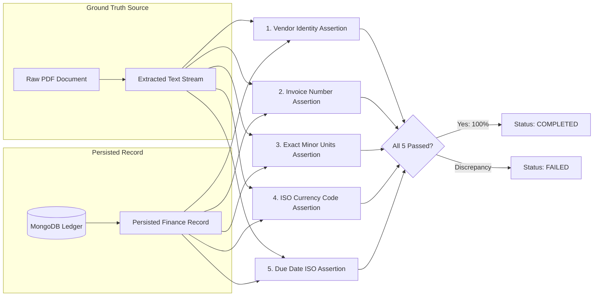

# WorkPilot: Comprehensive Technical Deep Dive & System Architecture

> **Project Name:** WorkPilot — An Autonomous AI Employee for Enterprise Workflows  
> **Author & Engineer:** Gara Sriram  
> **Repository:** [https://github.com/Gara-Sriram/WorkPilot](https://github.com/Gara-Sriram/WorkPilot)  
> **Target Alignment:** CentrAlign AI — Autonomous AI Employee & Task Worker

---

## Table of Contents
1. [Executive Summary & Core Philosophy](#1-executive-summary--core-philosophy)
2. [CentrAlign AI Core Loop Mapping](#2-centralign-ai-core-loop-mapping)
3. [End-to-End System Architecture](#3-end-to-end-system-architecture)
4. [Agentic Runtime & Controlled Execution Loop](#4-agentic-runtime--controlled-execution-loop)
5. [Modular Tool Registry & Zod Schemas](#5-modular-tool-registry--zod-schemas)
6. [Independent 5-Point Ground-Truth Verification Engine](#6-independent-5-point-ground-truth-verification-engine)
7. [Human-in-the-Loop Financial Governance](#7-human-in-the-loop-financial-governance)
8. [Database Architecture & Ledger Idempotency](#8-database-architecture--ledger-idempotency)
9. [Resilient Dual-Engine AI Architecture](#9-resilient-dual-engine-ai-architecture)
10. [Frontend Enterprise Dashboard & Error Resiliency](#10-frontend-enterprise-dashboard--error-resiliency)
11. [Automated Testing & Verification Suite](#11-automated-testing--verification-suite)
12. [Interview Defense & Architecture FAQs](#12-interview-defense--architecture-faqs)

---

## 1. Executive Summary & Core Philosophy

### The Fundamental Problem
Most modern generative AI applications are **conversational chatbots**. A user provides a prompt, and a Large Language Model generates an unstructured markdown or text response. If the model hallucinates an invoice total, misreads a due date, or misses an edge case, the human user is solely responsible for catching and correcting the error.

In an enterprise environment, conversational assistants do not solve the manual labor crisis:
- **No Direct Action:** Chatbots cannot reliably navigate enterprise file systems, validate financial schemas, or commit records to accounting ledgers.
- **Silent Hallucinations:** When an LLM claims it has completed a task, there is no cryptographic or ground-truth proof that the record exists or matches the source document.
- **Runaway Loops:** Naive multi-agent setups ("Agent A chats with Agent B") often devolve into non-deterministic deadlocks, runaway token bills, and debugging opacity.

### The WorkPilot Paradigm: The Autonomous AI Employee
WorkPilot is an **Autonomous AI Employee** engineered from first principles for mission-critical enterprise workflows. Given a natural-language business directive:
$$\text{"Find the latest Acme Technologies invoice, extract its details, create a finance record, and verify it."}$$

WorkPilot autonomously bridges the gap between **unstructured documents (PDF invoices)** and **persistent business applications (General Ledger / Accounts Payable databases)** with zero tolerance for hallucination.

```
┌────────────────────────────────────────────────────────────────────────┐
│                        TRADITIONAL CHATBOT                             │
│  User Prompt ────────> LLM Generates Text ────────> Human Does Work   │
└────────────────────────────────────────────────────────────────────────┘

┌────────────────────────────────────────────────────────────────────────┐
│                        WORKPILOT AI EMPLOYEE                           │
│  User Directive ──> Plan ──> Tool Execution ──> State DB ──> Ground-Truth Verification ──> Completed Outcome │
└────────────────────────────────────────────────────────────────────────┘
```

---

## 2. CentrAlign AI Core Loop Mapping

The CentrAlign AI Problem Statement explicitly outlines the operational loop required for an enterprise AI employee:
$$\mathbf{Goal \longrightarrow Understand \longrightarrow Plan \longrightarrow Execute \longrightarrow Observe \longrightarrow Adapt \longrightarrow Verify \longrightarrow Complete}$$

WorkPilot implements this loop as an explicit, deterministic finite-state machine in [`server/src/agent/runtime.js`](file:///d:/Projects/WorkPilot/server/src/agent/runtime.js):

| CentrAlign AI Phase | WorkPilot Architectural Implementation | Source Module |
| :--- | :--- | :--- |
| **1. Goal** | User submits a natural-language directive via the dashboard or REST API. | [`taskRoutes.js`](file:///d:/Projects/WorkPilot/server/src/routes/taskRoutes.js) |
| **2. Understand** | High-level goal interpretation, entity extraction (vendor, invoice #), and completion criteria formulation. | [`geminiClient.js`](file:///d:/Projects/WorkPilot/server/src/agent/geminiClient.js) (`interpretUserRequest`) |
| **3. Plan** | Structured plan synthesis generating an ordered array of discrete, typed tool calls. | [`geminiClient.js`](file:///d:/Projects/WorkPilot/server/src/agent/geminiClient.js) (`generateStructuredPlan`) |
| **4. Execute** | Sandboxed tool invocation constrained by Zod schema validation and operational budgets. | [`runtime.js`](file:///d:/Projects/WorkPilot/server/src/agent/runtime.js) (`executeStep`) |
| **5. Observe** | Structured output capture, execution event logging, and state synchronization. | [`Task.js`](file:///d:/Projects/WorkPilot/server/src/models/Task.js) (`executionHistory`) |
| **6. Adapt** | Step parameter resolution (`$step_1.matches[0].documentId`), exponential backoff retries, and governance locks. | [`runtime.js`](file:///d:/Projects/WorkPilot/server/src/agent/runtime.js) (`resolveDynamicArgs`) |
| **7. Verify** | **Independent 5-point ground-truth audit** comparing persisted DB records against raw PDF text. | [`verificationService.js`](file:///d:/Projects/WorkPilot/server/src/services/verificationService.js) |
| **8. Complete** | Final status transition to `COMPLETED` accompanied by completion evidence and summary telemetry. | [`runtime.js`](file:///d:/Projects/WorkPilot/server/src/agent/runtime.js) |

---

## 3. End-to-End System Architecture

```mermaid
flowchart TD
    subgraph Client Layer [Frontend Client - React 19 + Vite]
        UI[Enterprise Operator Dashboard]
        EB[React Error Boundary]
        UI --> EB
        EB --> OverviewTab[Overview & Scenarios]
        EB --> TasksTab[Tasks & Live Execution]
        EB --> DocsTab[PDF Document Repository]
        EB --> FinTab[General Ledger Records]
        EB --> ApprTab[Governance & Approvals]
    end

    subgraph Gateway [API Gateway & Middleware]
        Express[Node.js + Express Gateway]
        RateLimit[IP Rate Limiter]
        Multer[10MB PDF Upload Guard]
        ErrorHandler[Centralized Error Formatter]
        UI -->|HTTP / JSON| Express
        Express --> RateLimit
        Express --> Multer
        Express --> ErrorHandler
    end

    subgraph Agent Core [Controlled Agent Runtime]
        Runtime[Agent Execution Controller]
        Context[Execution Memory & Context]
        Interpreter[Intent Parser]
        Planner[Structured Planner]
        DualAI[Gemini SDK + Deterministic Fallback Engine]
        
        Express --> Runtime
        Runtime <--> Context
        Runtime --> Interpreter
        Runtime --> Planner
        Interpreter <--> DualAI
        Planner <--> DualAI
    end

    subgraph Governance & Policy [Enterprise Governance Gateways]
        GovLock{Amount >= $10,000?}
        PauseTask[Pause Task: WAITING_FOR_APPROVAL]
        HumanDecision[Human Officer Authorization]
        
        Runtime --> GovLock
        GovLock -->|Yes| PauseTask
        PauseTask --> HumanDecision
        HumanDecision -->|Approved| Runtime
        HumanDecision -->|Rejected| FailTask[Task FAILED]
    end

    subgraph Tool Registry [Modular Sandboxed Tools]
        Registry[Tool Registry & Zod Validation]
        T1[search_documents]
        T2[extract_invoice]
        T3[validate_invoice]
        T4[create_finance_record]
        T5[get_finance_record]
        T6[verify_finance_record]
        T7[request_human_approval]
        
        Runtime --> Registry
        Registry --> T1 & T2 & T3 & T4 & T5 & T6 & T7
    end

    subgraph Document Layer [Document Intelligence]
        PDFEngine[unpdf / PDF.js Parser]
        Storage[(Local / Cloud PDF Store)]
        T1 & T2 --> PDFEngine
        PDFEngine --> Storage
    end

    subgraph Ledger Layer [Enterprise Persistence]
        MongoDB[(MongoDB Atlas / In-Memory Server)]
        CompoundKey[Unique Compound Index: vendor + invoice]
        T4 & T5 --> MongoDB
        MongoDB --> CompoundKey
    end

    subgraph Verification Engine [Independent Outcome Verification]
        Verifier[5-Point Ground-Truth Verifier]
        T6 --> Verifier
        Verifier -->|Read Ground Truth| Storage
        Verifier -->|Read Persisted Record| MongoDB
        Verifier --> Report{5 Assertions Valid?}
        Report -->|100% Pass| Done[Task COMPLETED]
        Report -->|Discrepancy| DiscrepancyFail[Task FAILED]
    end
```



---

## 4. Agentic Runtime & Controlled Execution Loop

### The Single-Agent Philosophy
In contrast to multi-agent architectures where agents communicate in free-form natural language, WorkPilot implements a **single-agent controlled execution loop**:
1. **What the LLM Owns:** Intent understanding, entity discovery, initial plan formation, and dynamic argument extraction.
2. **What the Application Owns:** Tool schema validation, execution budgets, database transaction boundaries, policy thresholds, and ground-truth verification.

This guarantees deterministic boundaries, eliminates infinite conversational deadlocks, and provides complete compliance auditability.

### Operational Guardrails
- **Execution Budget:** Capped at a maximum of **10 tool calls** per task (`MAX_TOOL_CALLS = 10`).
- **Global Timeout:** Enforced **120-second hard timeout** (`TASK_TIMEOUT_MS = 120000`).
- **Transient Retry Engine:** Automatic step-level retry with exponential backoff (up to 3 attempts) for network timeouts or transient socket resets.
- **Dynamic Argument Propagation:** The agent runtime dynamically resolves upstream step references before invoking tools. For example:
  ```json
  "args": {
    "documentId": "$step_1.matches[0].documentId"
  }
  ```
  The runtime inspects `executionContext.stepOutputs`, evaluates the JSON path, and passes the concrete ID `doc_0cb53860dd08` to `extract_invoice`.

### Crash & Restart Recovery
When the Node.js server reboots, any tasks left in `RUNNING` or `VERIFYING` state are intercepted by [`taskService.recoverStaleTasks()`](file:///d:/Projects/WorkPilot/server/src/services/taskService.js#L130). Rather than blindly replaying non-idempotent operations (which could double-charge an invoice), WorkPilot marks the interrupted tasks as `FAILED`, records an audit event, and requires explicit operator initiation.

---

## 5. Modular Tool Registry & Zod Schemas

All tools are registered in [`server/src/tools/registry.js`](file:///d:/Projects/WorkPilot/server/src/tools/registry.js) and declared with strict **Zod schemas**. Arbitrary shell execution, raw SQL/NoSQL queries, and unconstrained file traversals are architecturally prohibited.

```
┌───────────────────────────────────────────────────────────────────┐
│                    TOOL CONTRACT LIFECYCLE                        │
│                                                                   │
│  Step Request ──> Zod Schema Validation ──> Execution ──> Result  │
│                         │                                         │
│                   Invalid Params?                                 │
│                         │                                         │
│                         ▼                                         │
│               Rejected Before Exec                                │
└───────────────────────────────────────────────────────────────────┘
```

### The 7 Production Enterprise Tools

#### 1. `search_documents`
- **Purpose:** Discovers relevant business documents in the repository using keyword, vendor, or invoice number queries.
- **Zod Schema:**
  ```javascript
  z.object({
    query: z.string().optional(),
    vendor: z.string().optional(),
    invoiceNumber: z.string().optional(),
    limit: z.number().int().min(1).max(20).default(5)
  })
  ```
- **Failsafe:** Returns an empty match list if no files match. Never invents phantom filenames.

#### 2. `extract_invoice`
- **Purpose:** Reads raw PDF binaries via `unpdf` and extracts structured invoice data.
- **Output Contract:**
  ```javascript
  {
    vendor: "Acme Technologies Inc.",
    invoiceNumber: "INV-2024-001",
    amount: 2450.00,
    amountCents: 245000,
    currency: "USD",
    invoiceDate: "2024-10-15",
    dueDate: "2024-11-15",
    lineItems: [...]
  }
  ```

#### 3. `validate_invoice`
- **Purpose:** Enforces domain-level business constraints prior to database persistence.
- **Checks:** Ensures positive non-zero total, valid ISO 8601 calendar dates, recognized ISO 4217 currency code, and non-empty vendor/invoice identifiers.

#### 4. `create_finance_record`
- **Purpose:** Persists verified accounts payable records to the MongoDB ledger.
- **Integrity Guard:** Evaluates the database-level unique compound index (`vendorNormalized__invoiceNumberNormalized`). If an invoice has already been recorded, MongoDB throws code `11000` (duplicate key), and the tool safely halts execution.

#### 5. `get_finance_record`
- **Purpose:** Queries previously persisted ledger records by record ID, vendor, or invoice number.
- **Usage:** Used by the agent to inspect ledger state and verify idempotency.

#### 6. `verify_finance_record`
- **Purpose:** Triggers the isolated 5-point ground-truth verification engine comparing the MongoDB record with the source PDF document.

#### 7. `request_human_approval`
- **Purpose:** Explicitly invoked or automatically triggered when an operation exceeds financial policy thresholds ($10,000+).
- **Behavior:** Persists an `ApprovalRequest` document and sets task status to `WAITING_FOR_APPROVAL`.

---

## 6. Independent 5-Point Ground-Truth Verification Engine

### The "Silent Hallucination" Problem
A fatal flaw in naive LLM architectures is accepting tool execution success as proof of task achievement:
$$\text{HTTP 200 OK} \neq \text{Business Outcome Correctness}$$

For example, an LLM might successfully invoke `create_finance_record`, but due to an attention lapse, input an amount of `$24.50` instead of `$2,450.00`. The database write succeeds, but the business outcome is corrupt.

### The 5-Point Assertion Engine
WorkPilot solves this with [`server/src/services/verificationService.js`](file:///d:/Projects/WorkPilot/server/src/services/verificationService.js). Before marking any task as `COMPLETED`, the system extracts raw text from the original PDF source and performs **5 deterministic assertions** against the MongoDB ledger record:



### The 5 Verification Dimensions:
1. **`VENDOR_MATCH`:** Verifies that the vendor name in the database matches the raw document text using normalized string comparison.
2. **`INVOICE_NUMBER_MATCH`:** Confirms the exact alphanumeric invoice code is present in the source text.
3. **`AMOUNT_EXACT_MATCH`:** Audits the monetary value down to integer cents (`amountCents`). Prevents rounding drift and decimal truncations.
4. **`CURRENCY_MATCH`:** Ensures currency alignment (e.g., `USD` vs. `EUR`).
5. **`DUE_DATE_MATCH`:** Confirms payment deadline parity against extracted calendar dates.

If **any** assertion fails, the task transitions to `FAILED`, the finance record is flagged as unverified, and a discrepancy audit diff is generated for operator review.

---

## 7. Human-in-the-Loop Financial Governance

Enterprise compliance requires that AI agents cannot unilaterally execute high-value transactions.

### The $10,000 Threshold Trigger
WorkPilot implements autonomous policy governance configured via `APPROVAL_THRESHOLD_AMOUNT = 10000`:
1. When `extract_invoice` or `create_finance_record` detects an amount $\ge \$10,000$ (e.g. Globex Logistics at **$14,800.00**), the runtime halts execution.
2. The task enters `WAITING_FOR_APPROVAL` state.
3. An immutable `ApprovalRequest` record is generated with:
   - `actionDescription`: Details of the pending transaction.
   - `amount` & `currency`: Operation value.
   - `reason`: Corporate policy threshold compliance.
4. In the UI, the top navigation and sidebar pulse with an amber alert indicator.
5. An authorized operator opens the **Approvals** dashboard, reviews the justification, inputs identity and commentary, and decides:
   - **Authorize:** The task resumes execution, commits the ledger write, and completes verification.
   - **Reject:** The task immediately transitions to `FAILED`, records an audit event, and halts execution safely.

```
┌────────────────────────────────────────────────────────────────────────┐
│                        GOVERNANCE AUDIT RECORD                         │
│  Approval ID: appr_8f912c019a                                          │
│  Action: Create finance record for Globex Logistics                    │
│  Amount: USD 14,800.00                                                 │
│  Status: APPROVED                                                      │
│  Decided By: Enterprise Finance Officer                                │
│  Audit Note: "Verified against Q4 vendor budget and approved."         │
└────────────────────────────────────────────────────────────────────────┘
```

---

## 8. Database Architecture & Ledger Idempotency

WorkPilot uses MongoDB Atlas with Mongoose schema modeling, backed by an automatic fallback to `mongodb-memory-server` for zero-configuration local evaluation.

### Core Schemas

#### 1. `Task` (`Task.js`)
Tracks the complete execution trajectory, operational parameters, and audit history:
- `taskId`: Unique alphanumeric task identifier (`task_xxxxxxxxxxxx`).
- `userRequest`: Original natural-language prompt.
- `status`: State enum (`PENDING`, `RUNNING`, `WAITING_FOR_APPROVAL`, `VERIFYING`, `COMPLETED`, `FAILED`, `CANCELLED`).
- `plan`: Array of planned steps (`stepId`, `tool`, `args`, `status`, `result`, `error`).
- `executionHistory`: Chronological audit log of all events (`TASK_RECEIVED`, `TOOL_STARTED`, `TOOL_SUCCEEDED`, `VERIFICATION_SUCCEEDED`, etc.).
- `verificationReport`: Complete 5-point verification output with expected and actual assertion values.

#### 2. `FinanceRecord` (`FinanceRecord.js`)
Represents committed General Ledger / Accounts Payable transactions:
- `recordId`: Unique identifier (`fin_xxxxxxxxxxxx`).
- `vendor`: Vendor legal entity name.
- `invoiceNumber`: Invoice identifier.
- `amount`: Floating-point representation.
- `amountCents`: Integer minor currency units (e.g. `$2,450.00` = `245000` cents).
- `uniqueCompositeKey`: Database-enforced compound key:
  $$\text{uniqueCompositeKey} = \text{vendorNormalized} + \text{"\_\_"} + \text{invoiceNumberNormalized}$$
  Backed by a `unique: true` index. Any attempt to record a duplicate invoice fails atomically with MongoDB code `11000`.

#### 3. `Document` (`Document.js`)
Maintains metadata, storage paths, and extraction status for all uploaded business documents.

#### 4. `ApprovalRequest` (`ApprovalRequest.js`)
Immutable audit trail for human-in-the-loop governance decisions.

---

## 9. Resilient Dual-Engine AI Architecture

WorkPilot communicates with Google Gemini via the official `@google/genai` SDK (`geminiClient.js`).

### Latency Guardrails & Fallback Strategy
Cloud AI endpoints can experience network latency, quota saturation (HTTP 429), or temporary demand spikes (HTTP 503). To guarantee zero hangs:
1. **7-Second Guard Timer:** Every cloud LLM request is wrapped in a 7-second Promise timeout (`withTimeout`).
2. **Automatic Failover:** If the Gemini endpoint times out or returns an error, WorkPilot immediately switches to its internal **Deterministic Fallback Engine**.
3. **Transparent Reporting:** The UI sidebar explicitly indicates whether the system is operating in **Live Gemini** or **Deterministic Agent** mode, ensuring 100% transparency.

```
┌────────────────────────────────────────────────────────┐
│                   DUAL-ENGINE AI FLOW                  │
│                                                        │
│                    User Directive                      │
│                          │                             │
│                          ▼                             │
│                 Live Gemini Flash API                  │
│                          │                             │
│             ┌────────────┴────────────┐                │
│             │                         │                │
│         Success                    Timeout /           │
│         (< 7s)                     503 Error           │
│             │                         │                │
│             ▼                         ▼                │
│       Live AI Plan          Deterministic Planner      │
│             │                         │                │
│             └────────────┬────────────┘                │
│                          │                             │
│                          ▼                             │
│                 Agent Execution Loop                   │
└────────────────────────────────────────────────────────┘
```

---

## 10. Frontend Enterprise Dashboard & Error Resiliency

Built with **React 19**, **Vite**, and **Tailwind CSS**, the frontend delivers an enterprise SaaS experience with zero blank-page crashes.

### Key Frontend Capabilities
1. **Global React Error Boundary ([`ErrorBoundary.jsx`](file:///d:/Projects/WorkPilot/client/src/components/common/ErrorBoundary.jsx)):** Wraps all view components. If an unexpected JavaScript exception occurs, it displays a diagnostic card with error telemetry and recovery buttons ("Retry View", "Return to Overview"), preventing the entire application from unmounting.
2. **Overview Dashboard ([`OverviewView.jsx`](file:///d:/Projects/WorkPilot/client/src/components/dashboard/OverviewView.jsx)):** High-level KPI metric cards, one-click pre-configured demonstration workflows, and live task/ledger previews.
3. **Task Runner & Verifier ([`TasksView.jsx`](file:///d:/Projects/WorkPilot/client/src/components/tasks/TasksView.jsx)):** Real-time execution stepper, independent 5-point verification badge, and interactive audit timeline.
4. **Document Repository ([`DocumentsView.jsx`](file:///d:/Projects/WorkPilot/client/src/components/documents/DocumentsView.jsx)):** Drag-and-drop PDF upload zone with raw text extraction inspector modal.
5. **General Ledger ([`FinanceView.jsx`](file:///d:/Projects/WorkPilot/client/src/components/finance/FinanceView.jsx)):** Persisted records table displaying minor currency units and composite uniqueness keys.
6. **Governance Gateway ([`ApprovalsView.jsx`](file:///d:/Projects/WorkPilot/client/src/components/approvals/ApprovalsView.jsx)):** High-value transaction authorization cards with officer identity and commentary inputs.

---

## 11. Automated Testing & Verification Suite

WorkPilot includes a test suite built on **Vitest** and **Supertest**. All test files execute sequentially (`fileParallelism: false`) against an automated in-memory MongoDB instance to eliminate race conditions and cloud network dependencies.

```bash
npm test
```

### Test Suite Inventory (20 Tests / 6 Suites):
1. **`health.test.js` (2 tests):** System health diagnostics, Gemini API key transparency, and demo statistics.
2. **`tools.test.js` (5 tests):** Unknown tool rejection, schema validation, and tool execution isolation.
3. **`finance.test.js` (4 tests):** Compound unique index duplicate prevention (code 11000) and integer minor units precision.
4. **`verification.test.js` (3 tests):** 5-point ground-truth verification assertions and discrepancy detection.
5. **`approvals.test.js` (2 tests):** $10,000 threshold locks, pending state persistence, and rejection workflows.
6. **`workflow.test.js` (4 tests):** End-to-end autonomous workflow execution, input validation, and zero-fabrication failure handling.

---

## 12. Interview Defense & Architecture FAQs

### Q1: Why did you build a single-agent loop instead of multi-agent orchestration (e.g. AutoGen / CrewAI)?
> *"In enterprise production, multi-agent conversational patterns introduce severe non-determinism, unpredictable token consumption, and debugging opacity. For structured enterprise workflows like Accounts Payable, a single-agent controlled loop is superior: the LLM is leveraged where it excels (semantic understanding and flexible planning), while deterministic software enforces schemas, operational budgets, transaction boundaries, and verification."*

### Q2: How does WorkPilot eliminate AI hallucinations in financial transactions?
> *"Through a defense-in-depth architecture: 1) Strict Zod schema validation on tool inputs. 2) Database-level compound unique indexes that prevent duplicate insertions. 3) Integer minor units (`amountCents`) that eliminate floating-point drift. 4) An independent 5-point verification engine that compares the database record against the raw PDF text across 5 dimensions before permitting the task to complete."*

### Q3: What happens if an invoice has already been processed?
> *"The database uniqueness constraint on `vendorNormalized__invoiceNumberNormalized` rejects the insert with MongoDB code 11000. WorkPilot catches the violation cleanly, logs the duplicate attempt, and terminates execution safely without corrupting the ledger."*

### Q4: How would this architecture scale to thousands of concurrent enterprise tasks?
> *"1) Offload the execution loop from the Express process to a distributed orchestration engine (e.g., Temporal or BullMQ) with isolated worker pools. 2) Abstract the local PDF storage layer to an object store like Amazon S3 or Google Cloud Storage. 3) Implement long-term company memory using pgvector to store organization-specific General Ledger account codes and historical approval patterns."*

---

<div align="center">
  <b>WorkPilot — Autonomous AI Employee for Enterprise Workflows</b><br>
  Built with passion for the CentrAlign AI Engineering Challenge.
</div>
