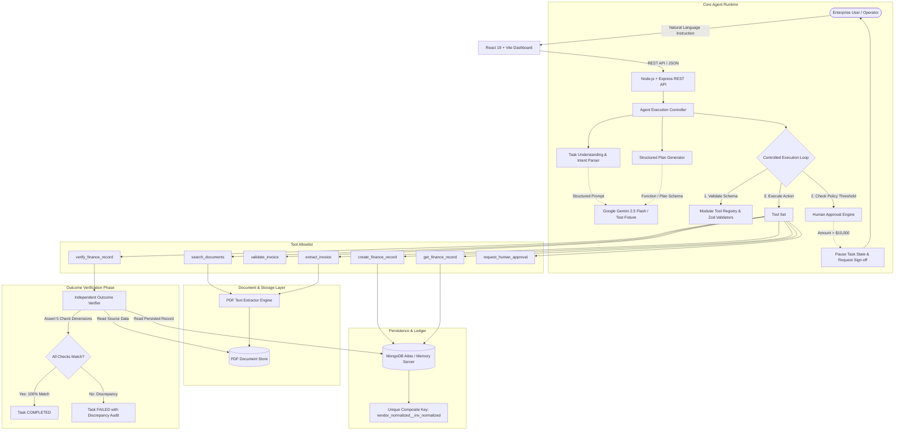

# WorkPilot — An Autonomous AI Employee for Enterprise Workflows

> **Tagline:** *From instructions to verified outcomes.*

WorkPilot is an autonomous AI employee designed for enterprise workflows. Unlike generic chatbots that merely generate conversational answers, WorkPilot takes natural-language business instructions, formulates structured execution plans, invokes sandboxed tools, handles transient failures with bounded retries, maintains persistent task state, and **independently verifies that the business outcome was achieved before marking a task completed**.

The initial workflow implementation is focused on high-fidelity **Accounts Payable & Invoice Processing**, demonstrating how an enterprise AI employee bridges the gap between unstructured documents (PDF invoices) and persistent business applications (General Ledger / Accounts Payable database).

---

## Architecture Overview



---

## Key Features

1. **Autonomous Task Planning & Tool Execution:**
   - Translates natural-language business requests into an ordered sequence of executable steps.
   - Constrained by a strict execution budget: default maximum of 10 tool calls per task and global timeout protection to prevent infinite loops.

2. **Real PDF Document Processing:**
   - Real PDF parsing using modern PDF.js (`unpdf`) with magic header validation and file-size guardrails (10 MB limit).
   - Never fabricates invoice content or claims to read a document when extraction fails.

3. **Modular Tool Registry with Zod Validation:**
   - Sandboxed tool allowlist: `search_documents`, `extract_invoice`, `validate_invoice`, `create_finance_record`, `get_finance_record`, `verify_finance_record`, and `request_human_approval`.
   - Every tool call requires strict Zod schema validation before execution is permitted. Arbitrary code execution and shell commands are strictly prohibited.

4. **Independent Outcome Verification:**
   - A database write acknowledgement alone is **never** accepted as proof of success.
   - The verification engine independently compares the persisted record against the original source document across 5 dimensions: **Vendor Identity**, **Invoice Number**, **Exact Cents Monetary Value**, **Currency Code**, and **Due Date**.
   - Tasks cannot transition to `COMPLETED` unless verification passes with 100% fidelity.

5. **Human-in-the-Loop Governance:**
   - Any financial action exceeding the enterprise policy threshold ($10,000) automatically pauses execution and persists a pending approval request.
   - The LLM cannot bypass governance controls; execution resumes only when an authorized operator records an `APPROVED` decision with audit notes.

6. **Database-Enforced Duplicate Prevention:**
   - Protects against duplicate financial records using a database-level unique composite index (`vendorNormalized__invoiceNumberNormalized`).
   - Re-running the same task or re-submitting an invoice safely trips MongoDB duplicate-key constraints (code 11000) and halts with a domain error instead of corrupting the ledger.

7. **Exact Cents Monetary Math:**
   - Stored using integer minor currency units (`amountCents`) alongside float amounts to eliminate IEEE-754 floating-point rounding errors during financial verification.

8. **Crash & Restart Recovery:**
   - Tasks stuck in `RUNNING` or `VERIFYING` across server restarts are safely detected and marked `FAILED` with recovery audit logs, preventing blind replays of non-idempotent operations.

9. **Live AI or High-Fidelity Test Fixture Mode:**
   - Seamlessly uses the official `@google/genai` SDK when `GEMINI_API_KEY` is configured.
   - Transparently falls back to a deterministic test engine when no API key is provided, clearly indicating demo mode in the UI without faking results.

---

## Technology Stack

| Component | Technology | Rationale |
| :--- | :--- | :--- |
| **Frontend Framework** | React 19, Vite | Fast, modern component model with instant HMR |
| **Styling** | Tailwind CSS | Clean Linear/Vercel enterprise SaaS design system |
| **Icons** | Lucide React | Modern, accessible SVG icon library |
| **Backend Framework** | Node.js (v24), Express.js | Modular, asynchronous event-driven REST API |
| **Database & ODM** | MongoDB Atlas / Mongoose | Flexible document model with schema indexing and constraints |
| **In-Memory Fallback** | `mongodb-memory-server` | Zero-configuration local startup and automated testing |
| **AI SDK** | `@google/genai` (official) | Current Google Gen AI SDK with structured outputs |
| **Schema Validation** | Zod (v3) | Runtime argument and environment variable validation |
| **PDF Extraction** | `unpdf` (PDF.js) | Standards-compliant PDF parsing without native binary deps |
| **File Uploads** | Multer | Memory-buffered safe uploads with size and mime checking |
| **Test Runner** | Vitest, Supertest | Fast unit and integration tests with deterministic fixtures |

---

## Why a Single Agent Instead of Multi-Agent?

In real-world enterprise automation, introducing multiple conversational agents that chat with one another often leads to non-deterministic failure modes, unconstrained token loops, latency spikes, and obscure debugging traces.

WorkPilot adopts a **single-agent controlled execution loop**:
- **What the LLM Controls:** High-level intent comprehension, initial structured planning, dynamic parameter extraction, and step re-planning upon observing errors.
- **What the Application Controls:** Tool validation, execution budgeting, permission checks, database transaction boundaries, duplicate prevention, and independent outcome verification.

This architecture delivers maximum auditability, deterministic boundaries, and reliable enterprise compliance.

---

## Project Structure

```
WorkPilot/
├── package.json                   # Root orchestrator scripts (dev, test, build)
├── .gitignore                     # Git ignore rules (node_modules, .env, uploads)
├── scripts/
│   └── dev.js                     # Cross-platform concurrent dev server runner
├── server/
│   ├── package.json               # Backend dependencies and test scripts
│   ├── .env.example               # Configuration template
│   ├── .env                       # Local environment file
│   ├── vitest.config.js           # Vitest test configuration
│   ├── src/
│   │   ├── index.js               # Server entrypoint and graceful shutdown
│   │   ├── app.js                 # Express app, CORS, routes, error handling
│   │   ├── config/
│   │   │   ├── env.js             # Zod environment validation
│   │   │   └── db.js              # MongoDB Atlas + MongoMemoryServer fallback
│   │   ├── models/
│   │   │   ├── Task.js            # Task execution state and event timeline
│   │   │   ├── Document.js        # PDF metadata and extracted text
│   │   │   ├── FinanceRecord.js   # Ledger records with unique composite index
│   │   │   └── ApprovalRequest.js # Human-in-the-loop governance requests
│   │   ├── agent/
│   │   │   ├── runtime.js         # Controlled execution loop & budget limits
│   │   │   └── geminiClient.js    # Gemini SDK integration & fallback engine
│   │   ├── tools/
│   │   │   ├── registry.js        # Tool registry and argument validation
│   │   │   └── index.js           # The 7 core enterprise tools
│   │   ├── services/
│   │   │   ├── documentService.js # Document upload and search engine
│   │   │   ├── pdfService.js      # Robust PDF text extraction
│   │   │   ├── financeService.js  # Ledger operations and duplicate handling
│   │   │   ├── taskService.js     # Task lifecycle and restart recovery
│   │   │   ├── approvalService.js # Governance approval workflows
│   │   │   ├── verificationService.js # Independent 5-check outcome verifier
│   │   │   └── demoSeeder.js      # Sample invoice seeding
│   │   ├── fixtures/
│   │   │   └── generatePdfFixtures.js # Programmatic real PDF generator
│   │   ├── middleware/
│   │   │   ├── errorHandler.js    # Centralized HTTP error handling
│   │   │   ├── upload.js          # Multer 10MB PDF upload middleware
│   │   │   └── rateLimiter.js     # In-memory IP rate limiter
│   │   └── routes/
│   │       ├── healthRoutes.js    # /api/health diagnostics
│   │       ├── taskRoutes.js      # /api/tasks REST endpoints
│   │       ├── documentRoutes.js  # /api/documents REST endpoints
│   │       ├── financeRoutes.js   # /api/finance-records REST endpoints
│   │       ├── approvalRoutes.js  # /api/approvals REST endpoints
│   │       └── demoRoutes.js      # /api/demo seed and status endpoints
│   └── tests/
│       ├── setup.js               # Test suite setup and in-memory DB init
│       ├── health.test.js         # System health tests
│       ├── tools.test.js          # Tool validation and registry tests
│       ├── finance.test.js        # Ledger duplicate prevention tests
│       ├── verification.test.js   # Independent verification tests
│       ├── approvals.test.js      # Human governance threshold tests
│       └── workflow.test.js       # End-to-end autonomous workflow tests
└── client/
    ├── package.json               # Frontend dependencies
    ├── vite.config.js             # Vite proxy and dev configuration
    ├── tailwind.config.js         # Enterprise SaaS design system palette
    ├── index.html                 # App shell with Inter and JetBrains Mono fonts
    └── src/
        ├── main.jsx               # React DOM root
        ├── App.jsx                # Layout, tab management, and auto-polling
        ├── index.css              # Tailwind base styles and custom scrollbars
        ├── api/
        │   └── client.js          # REST API client
        └── components/
            ├── layout/
            │   ├── Sidebar.jsx    # Navigation, AI mode, and demo reset
            │   └── Header.jsx     # Header with status pills and New Task CTA
            ├── dashboard/
            │   └── OverviewView.jsx # Metric cards, presets, and summaries
            ├── tasks/
            │   └── TasksView.jsx  # Interactive runner, timeline, and verifier
            ├── documents/
            │   └── DocumentsView.jsx # Upload zone and text inspector
            ├── finance/
            │   └── FinanceView.jsx# Ledger table and composite key inspector
            ├── approvals/
            │   └── ApprovalsView.jsx # Human-in-the-loop authorization cards
            └── common/
                ├── Badge.jsx      # Color-coded enterprise status badge
                └── Modal.jsx      # Accessible modal dialog
```

---

## Getting Started

### Prerequisites
- **Node.js**: v18.0.0 or later (tested on v24.19.0)
- **NPM**: v9.0.0 or later
- **MongoDB** *(Optional)*: Local MongoDB or MongoDB Atlas URI. **If omitted, WorkPilot automatically initializes an in-memory MongoDB database so you can test immediately with zero external setup!**
- **Gemini API Key** *(Optional)*: If omitted, WorkPilot runs in deterministic demo fixture mode with visible UI indicators.

---

### Installation

Clone the repository and install all dependencies for both backend and frontend:

```bash
# From the root directory:
npm run install:all
```

Alternatively, install manually in each subfolder:
```bash
cd server && npm install
cd ../client && npm install
cd ..
```

---

### Environment Configuration

The application includes a documented `server/.env.example` file. Copy it to `server/.env`:

```bash
cp server/.env.example server/.env
```

Configuration variables:

```env
PORT=5000
NODE_ENV=development
CLIENT_ORIGIN=http://localhost:5173

# MongoDB Connection String:
# Leave blank to use zero-config in-memory MongoDB:
MONGODB_URI=

# Official Google Gemini API Key (https://aistudio.google.com/):
# Leave blank to run in deterministic demo fixture mode:
GEMINI_API_KEY=

# Supported Gemini Model:
GEMINI_MODEL=gemini-2.5-flash

# Autonomous execution parameters:
MAX_TOOL_CALLS=10
MAX_RETRIES=3
TASK_TIMEOUT_MS=120000

# Enterprise Approval threshold (amounts above $10,000 require sign-off):
APPROVAL_THRESHOLD_AMOUNT=10000
```

---

### Running the Application

You can launch both the backend server and frontend development client with a single command from the project root:

```bash
npm run dev
```

- **Frontend Client:** [http://localhost:5173](http://localhost:5173)
- **Backend API:** [http://localhost:5000](http://localhost:5000)
- **Health Diagnostics:** [http://localhost:5000/api/health](http://localhost:5000/api/health)

---

### Running the Automated Tests

WorkPilot includes a test suite covering the health endpoint, tool argument validation, duplicate finance prevention, independent outcome verification, human approval governance, and end-to-end autonomous workflows:

```bash
npm test
```

Or from the `server/` directory:
```bash
cd server
npm test
```

All 6 test suites and 20 tests execute against an isolated in-memory test database:
- `tests/health.test.js`: System health and transparency diagnostics
- `tests/tools.test.js`: Unknown tool rejection and argument validation
- `tests/finance.test.js`: Duplicate key prevention and exact cents math
- `tests/verification.test.js`: 5-point independent verification assertions
- `tests/approvals.test.js`: Policy threshold detection and rejection handling
- `tests/workflow.test.js`: Complete autonomous execution loop to verified completion

---

## Step-by-Step Demonstration Script

### Scenario 1: The Happy Path (Autonomous Discovery, Extraction, Persistence & Verification)
1. Open the dashboard at [http://localhost:5173](http://localhost:5173).
2. On the **Overview** page or **Tasks** page, click the quick preset:
   > *"Find the latest Acme Technologies invoice, extract its details, create a finance record, and verify it."*
3. Click **Run Task**.
4. Observe the live execution:
   - **Step 1 (`search_documents`):** Locates `Acme_Technologies_Invoice_INV-2024-001.pdf`.
   - **Step 2 (`extract_invoice`):** Extracts vendor name, invoice number (`INV-2024-001`), amount (`USD 2450.00`), invoice date (`2024-10-15`), and due date (`2024-11-15`).
   - **Step 3 (`validate_invoice`):** Verifies data types, positive amount, and date formats.
   - **Step 4 (`create_finance_record`):** Persists the record to MongoDB with exact integer cents (`245000`).
   - **Step 5 (`verify_finance_record`):** Reads the newly created database record, compares it against the raw source invoice, and passes all 5 verification assertions.
5. The task status transitions to **COMPLETED** only after independent verification passes.
6. Navigate to the **Finance Records** tab to inspect the verified record.

### Scenario 2: Human-in-the-Loop Governance ($14,800 High-Value Policy Threshold)
1. In the **Tasks** page, run:
   > *"Find the Globex Logistics invoice GLX-9942, extract details, create finance record, and verify."*
2. Observe execution pause at Step 4:
   - The invoice amount is **$14,800.00**, exceeding the corporate threshold of **$10,000.00**.
   - The agent sets task status to `WAITING_FOR_APPROVAL` and emits an audit event.
3. In the sidebar or top banner, notice the alert: `1 Action Requires Human Approval`.
4. Click into the **Approvals** tab.
5. Click **Authorize Action**, input your officer name and audit comments, and confirm.
6. The agent loop automatically resumes and completes the task.
7. Alternatively, test **Reject** to see the task safely halted and marked as `FAILED`.

### Scenario 3: Failure Handling & Zero-Fabrication Guarantee
1. In the **Tasks** page, enter:
   > *"Find and verify invoice for QuantumLeap Innovations Corp."*
2. Observe that the agent executes `search_documents`, finds 0 matches in the repository, and halts execution safely with status `FAILED`.
3. Notice that the agent **does not invent a fake invoice** or claim success when no matching document exists.

### Scenario 4: Database Duplicate Prevention
1. Re-run the Acme Technologies prompt from Scenario 1.
2. The agent attempts to insert another record with composite key `acmetechnologiesinc__inv2024001`.
3. The database uniqueness constraint rejects the insert with duplicate-key code 11000.
4. The system catches the error, halts execution, and prevents duplicate financial records.

---

## Security Considerations

1. **Backend Secret Isolation:** `GEMINI_API_KEY` and `MONGODB_URI` reside solely on the backend process. Vite never exposes credentials to the client bundle.
2. **Untrusted Invoice Content Defenses:** PDF text is treated strictly as data payloads, never as system instructions. Indirect prompt injection attacks (such as embedded text instructing the model to ignore rules or transfer funds) cannot alter backend tool permissions or policy thresholds.
3. **Strict Tool Allowlist & Sandboxing:** Only explicitly registered tools with Zod schemas can be executed. Shell commands, arbitrary file system traversal, and unconstrained DB queries are prohibited.
4. **Input Sanitization & Upload Guardrails:** Uploads are limited to 10 MB and validated for `%PDF-` magic header bytes before processing.
5. **Rate Limiting & CORS:** The API applies in-memory rate limiting and restricts CORS origins to the configured client URL.

---

## Known Limitations & Trade-Offs

- **Single-User Demo Prototype:** Authentication is simplified to a single operator persona. In a multi-tenant production environment, role-based access control (RBAC) with JWT or OAuth2 would be layered onto the approval and task services.
- **Local PDF Storage:** Uploaded PDFs are stored in `server/uploads/` on the local disk. In a cloud deployment, this layer would plug into S3 or Google Cloud Storage.
- **Synchronous Execution Loop:** For this prototype, tasks run in an asynchronous in-process loop with MongoDB persistence. For high-volume multi-thousand concurrent enterprise queues, an external task orchestrator (such as Temporal or BullMQ) would manage worker distribution.

---

## Resume-Ready Project Descriptions

Use these bullet points to highlight the engineering achievements demonstrated by WorkPilot:

- **Autonomous Agent Runtime & Planning:** Built an autonomous AI employee in Node.js/Express and React that interprets natural-language business requests, generates structured execution plans via Google Gemini, and autonomously invokes sandboxed tools with Zod argument validation and bounded retries.
- **Persistent Workflow State & Failure Recovery:** Designed a persistent task state machine in MongoDB handling restart recovery, rate limiting, and human-in-the-loop governance locks for financial operations exceeding enterprise policy thresholds ($10,000+).
- **Idempotent Ledger & Independent Outcome Verification:** Engineered a reliable accounts payable pipeline featuring database-level unique composite keys to prevent duplicate records, exact-integer minor unit monetary calculations, and an independent 5-point verification engine that audits persisted records against raw PDF text before permitting task completion.
