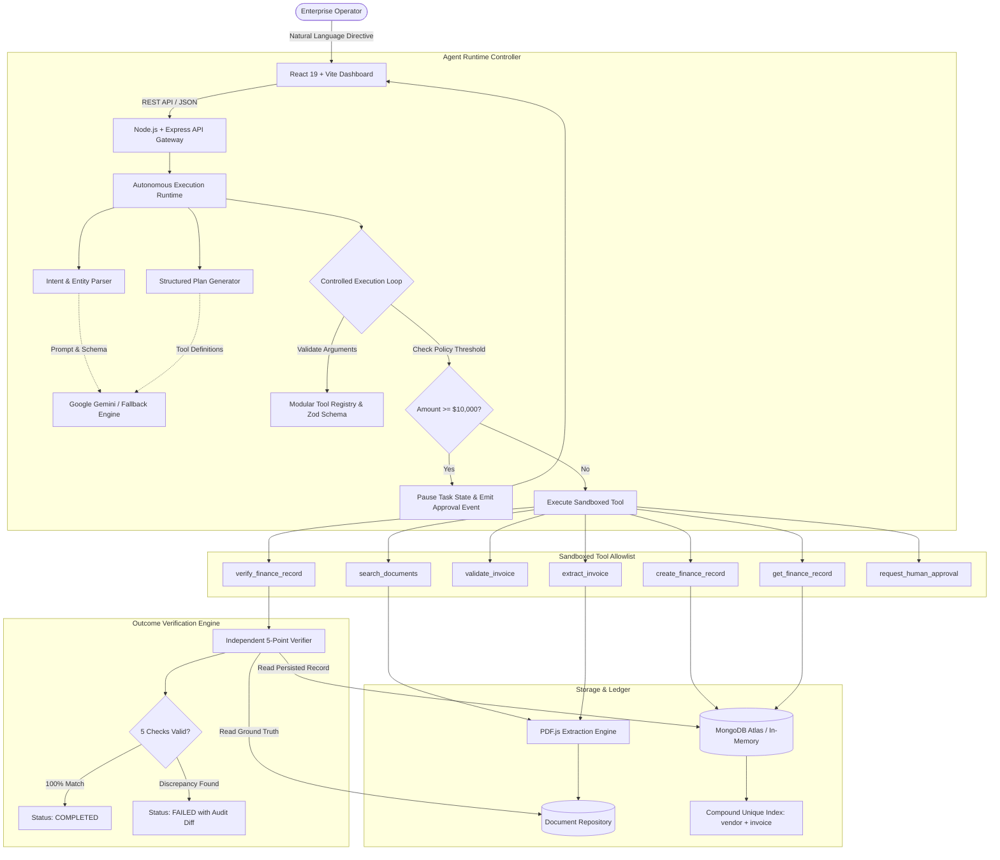
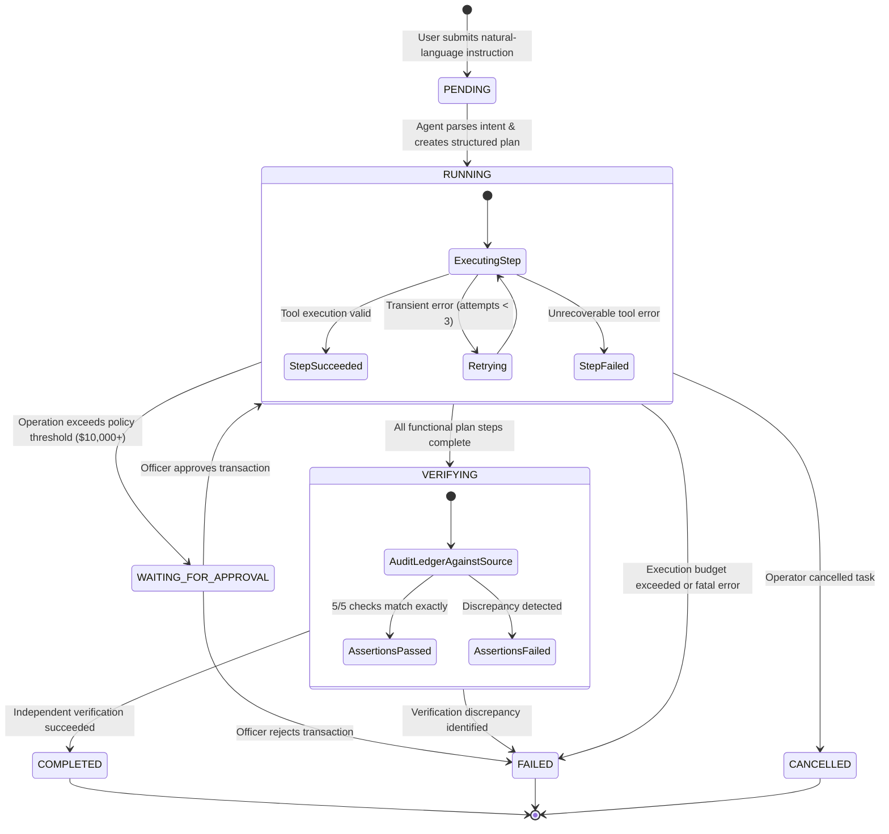

# WorkPilot — Autonomous AI Employee for Enterprise Workflows

<div align="center">


[](https://nodejs.org/)
[](https://react.dev/)
[](https://www.mongodb.com/)
[](https://ai.google.dev/)
[](https://vitejs.dev/)
[](https://tailwindcss.com/)
[](https://vitest.dev/)
[](LICENSE)

[](https://render.com/deploy?repo=https://github.com/Gara-Sriram/WorkPilot)

[](https://workpilot-hnvp.onrender.com)

**From natural-language instructions to independently verified business outcomes.**

🌐 **Live Production App:** [https://workpilot-hnvp.onrender.com](https://workpilot-hnvp.onrender.com)

[Live Demo](https://workpilot-hnvp.onrender.com) • [Key Innovations](#key-engineering-innovations) • [System Architecture](#system-architecture) • [State Machine](#task-lifecycle-state-machine) • [Interactive Scenarios](#interactive-demonstration-scenarios) • [Quickstart](#getting-started)

</div>

---

## Executive Summary

Most generative AI projects are conversational chatbots: a user sends a prompt, and the model returns unstructured prose. If the model hallucinates or fails, the user is left to detect and correct the discrepancy manually.

**WorkPilot** is fundamentally different. It is an **Autonomous AI Employee** engineered for mission-critical enterprise workflows. Given a natural-language directive, WorkPilot:
1. **Formulates an actionable plan** with discrete, typed tool calls.
2. **Executes against real business backends** (extracting raw PDF invoices, validating schemas, persisting to General Ledger databases).
3. **Enforces human policy governance** whenever financial thresholds ($10,000+) are exceeded.
4. **Handles transient failures and bounded retries** without getting stuck in infinite loops.
5. **Independently verifies the outcome** by comparing persisted database records against raw source documents before permitting the task to complete.

The current implementation targets **Accounts Payable & Document Intelligence**, bridging unstructured business documents (PDF invoices) and transactional accounting systems (MongoDB General Ledger) with zero-tolerance for hallucination.

---

## Key Engineering Innovations

### 1. Independent Ground-Truth Verification
*The Problem:* In standard AI agents, a tool returning `success: true` or a database write acknowledgement is accepted as mission completion. This allows subtle hallucinations (e.g. altered invoice numbers or minor rounding errors) to enter enterprise ledgers undetected.

*The Solution:* WorkPilot mandates an **Independent Outcome Verification Phase**. After creating a finance record, the agent triggers an isolated verification engine that audits the database document directly against raw PDF source text across **5 discrete assertion dimensions**:
- **Vendor Identity Match:** Exact string matching against parsed vendor metadata.
- **Invoice Number Match:** Strict alphanumeric identifier alignment.
- **Exact Cents Value:** Exact minor unit match (`amountCents`) eliminating floating-point rounding errors.
- **Currency Code:** ISO currency format compliance (e.g., `USD`).
- **Due Date Match:** ISO 8601 calendar date parity.

A task **cannot** transition to `COMPLETED` unless all 5 verification assertions pass with 100% fidelity.

---

### 2. Controlled Execution Loop & Budgeting
*The Problem:* Unbounded multi-agent loops frequently suffer from conversational deadlocks, non-deterministic latency spikes, and runaway token consumption.

*The Solution:* WorkPilot utilizes a **single-agent controlled execution loop** with strict deterministic operational boundaries:
- **Maximum Execution Budget:** Capped at 10 tool calls per task.
- **Global Timeout Guard:** Enforced 120-second hard timeout.
- **Transient Failure Retries:** Step-level exponential backoff capped at 3 attempts for network errors.
- **Dynamic Context Propagation:** Parameter outputs from prior steps (such as extracted document IDs) are automatically resolved and injected into downstream tool arguments.

---

### 3. Human-in-the-Loop Financial Governance
*The Problem:* Fully autonomous financial execution poses significant compliance and regulatory risks if high-value transactions execute without human sign-off.

*The Solution:* WorkPilot enforces hard policy thresholds at the runtime level. Any operation involving transactions **$\ge \$10,000$** triggers an automatic governance lock:
- The execution loop halts immediately, transitioning task state to `WAITING_FOR_APPROVAL`.
- An immutable `ApprovalRequest` record is persisted with transaction justification.
- The UI triggers an interactive governance modal requiring an authenticated officer's decision and commentary.
- Rejection terminates execution safely; approval resumes the workflow and commits the transaction to the ledger.

---

### 4. Database-Enforced Idempotency & Financial Precision
- **Unique Composite Key:** Prevents duplicate payments and re-submission errors via a database-level unique compound index: `vendorNormalized__invoiceNumberNormalized`. Re-processing an invoice trips MongoDB code 11000 and is handled cleanly as a business rule failure.
- **Integer Minor Units:** All monetary values are calculated and stored in integer cents (`amountCents`) alongside standard floats, preventing IEEE-754 floating-point inaccuracies during ledger calculations.

---

### 5. Resilient Dual-Engine AI Architecture
- **Official `@google/genai` Integration:** Connects directly to Google's next-generation Gemini SDK (`gemini-flash-latest`) for live intent interpretation and plan synthesis.
- **Cloud Latency Guardrails:** Incorporates a 7-second timeout wrapper around cloud model requests.
- **Deterministic Fallback Engine:** If cloud APIs experience quota exhaustion (HTTP 429), spikes in demand (HTTP 503), or network latency, WorkPilot automatically fails over to an internal deterministic planning engine without hanging or breaking the user experience.

---

## System Architecture



---

## Task Lifecycle State Machine

WorkPilot tracks every workflow through an explicit, persistent state machine stored in MongoDB:



---

## Technology Stack

| Layer | Technologies | Engineering Rationale |
| :--- | :--- | :--- |
| **Frontend UI** | **React 19**, **Vite**, **Tailwind CSS** | Instant hot-module replacement, modern component hierarchy, and zero-dependency production bundle |
| **Icons & UI Feedback** | **Lucide React** | Accessible, consistent SVG iconography across all system views |
| **Error Resiliency** | **Custom React ErrorBoundary** | Catches rendering exceptions and renders isolated diagnostic telemetry without unmounting the application |
| **Backend API** | **Node.js (v20+)**, **Express.js** | Non-blocking, asynchronous event loop optimized for I/O-intensive document extraction and tool orchestration |
| **Database & ODM** | **MongoDB Atlas**, **Mongoose** | Rich document model, schema-level composite indexing, and transactional write atomicity |
| **Zero-Config DB Fallback** | **`mongodb-memory-server`** | Automatically initializes an in-memory database if no external MongoDB URI is provided |
| **AI SDK** | **`@google/genai` (Official SDK)** | Direct integration with Google Gemini Flash models with structured prompt contracts |
| **Runtime Validation** | **Zod (v3)** | Enforces strict schema contracts on all incoming API requests and tool invocation parameters |
| **PDF Extraction Engine** | **`unpdf` (PDF.js)** | Standards-compliant PDF parsing with magic header validation and zero native binary dependencies |
| **Automated Testing** | **Vitest**, **Supertest** | High-speed unit and integration test runner executing 20 automated tests in < 3 seconds |

---

## Interactive Demonstration Scenarios

WorkPilot includes 3 pre-seeded business scenarios accessible directly from the **Overview** dashboard:

### Scenario 1: The Happy Path (Autonomous Discovery & Independent Verification)
- **Prompt:** `"Find the latest Acme Technologies invoice, extract its details, create a finance record, and verify it."`
- **Execution Flow:**
  1. `search_documents`: Locates `Acme_Technologies_Invoice_INV-2024-001.pdf`.
  2. `extract_invoice`: Extracts vendor name, invoice number (`INV-2024-001`), amount (`USD 2450.00`), invoice date (`2024-10-15`), and due date (`2024-11-15`).
  3. `validate_invoice`: Validates positive currency amounts and date formats via Zod.
  4. `create_finance_record`: Persists the record to MongoDB with exact integer cents (`245000`).
  5. `verify_finance_record`: Compares the persisted database record against raw PDF text. Passes all 5 verification assertions.
- **Outcome:** Status transitions to **COMPLETED** only after independent verification passes.

### Scenario 2: Human-in-the-Loop Governance ($14,800 Policy Lock)
- **Prompt:** `"Find the Globex Logistics invoice GLX-9942, extract details, create finance record, and verify."`
- **Execution Flow:**
  1. The agent discovers the document and extracts an amount of **$14,800.00**.
  2. Runtime detects that the amount exceeds the corporate policy limit of **$10,000.00**.
  3. Task execution automatically pauses; status transitions to `WAITING_FOR_APPROVAL`.
  4. The operator navigates to the **Approvals** view, inspects the transaction justification, inputs commentary, and authorizes the action.
  5. The execution loop resumes, commits the record, and completes the verification phase.

### Scenario 3: Graceful Failure & Zero-Fabrication Guarantee
- **Prompt:** `"Find and verify invoice for QuantumLeap Innovations Corp."`
- **Execution Flow:**
  1. `search_documents` executes and returns 0 matching documents in the repository.
  2. The agent recognizes the missing precondition and halts execution immediately with status `FAILED`.
  3. **Zero Fabrication:** The system never invents fake invoice numbers, amounts, or vendor details to force completion.

### Scenario 4: Database Duplicate Prevention
- Re-submitting the Acme Technologies workflow causes the database insert step to encounter the compound unique index `vendorNormalized__invoiceNumberNormalized`.
- MongoDB rejects the write with error code 11000.
- WorkPilot catches the duplicate violation, logs the incident, and terminates execution safely without corrupting ledger integrity.

---

## Project Structure

```
WorkPilot/
├── package.json                         # Monorepo orchestration scripts
├── .gitignore                           # Strict exclusion for .env and artifacts
├── README.md                            # Comprehensive system documentation
├── scripts/
│   └── dev.js                           # Cross-platform concurrent runner
├── server/
│   ├── package.json                     # Server dependencies and Vitest scripts
│   ├── .env.example                     # Documented configuration template
│   ├── vitest.config.js                 # Vitest test suite configuration
│   ├── fixtures/                        # Sample PDFs (Acme, Globex, Initech)
│   └── src/
│       ├── index.js                     # HTTP server startup & graceful shutdown
│       ├── app.js                       # Express configuration & middleware
│       ├── agent/
│       │   ├── runtime.js               # Controlled execution loop & budgeting
│       │   └── geminiClient.js          # Google Gemini SDK & fallback engine
│       ├── config/
│       │   ├── env.js                   # Zod environment variable validation
│       │   └── db.js                    # MongoDB Atlas + MongoMemoryServer
│       ├── middleware/
│       │   ├── errorHandler.js          # Centralized error formatting
│       │   ├── rateLimiter.js           # In-memory IP rate limiter
│       │   └── upload.js                # Multer PDF upload configuration
│       ├── models/
│       │   ├── Task.js                  # Task execution state machine
│       │   ├── Document.js              # PDF metadata and text index
│       │   ├── FinanceRecord.js         # Ledger records with compound unique key
│       │   └── ApprovalRequest.js       # Human governance records
│       ├── routes/                      # REST endpoints (/tasks, /documents, etc.)
│       ├── services/                    # Business logic (finance, PDF, verification)
│       └── tools/
│           ├── registry.js              # Tool registration & Zod argument checks
│           └── index.js                 # The 7 core sandboxed enterprise tools
└── client/
    ├── package.json                     # Frontend dependencies
    ├── vite.config.js                   # Vite configuration & backend proxy
    ├── tailwind.config.js               # Enterprise design system tokens
    ├── index.html                       # Shell with Inter & JetBrains Mono fonts
    └── src/
        ├── main.jsx                     # React root
        ├── App.jsx                      # App shell, tab router, auto-polling
        ├── api/client.js                # Type-safe fetch client for REST API
        └── components/
            ├── common/                  # ErrorBoundary, Badge, Modal dialogs
            ├── dashboard/               # OverviewView: metrics & preset scenarios
            ├── tasks/                   # TasksView: execution runner & audit log
            ├── documents/               # DocumentsView: PDF upload & text inspector
            ├── finance/                 # FinanceView: General ledger & record inspector
            └── approvals/               # ApprovalsView: Human governance review cards
```

---

## 🚀 One-Click Cloud Deployment (Render)

WorkPilot is configured with a unified deployment architecture. When built, the Express backend automatically serves the compiled React application, allowing the entire system to run seamlessly on a single cloud service.

### Option A: 1-Click Blueprint Deploy
1. Click the button below:  
   [](https://render.com/deploy?repo=https://github.com/Gara-Sriram/WorkPilot)
2. Connect your GitHub account and authorize the repository (`Gara-Sriram/WorkPilot`).
3. Fill in the two environment variables:
   - `MONGODB_URI`: Your MongoDB Atlas connection string (or leave empty to let WorkPilot launch an automated DB).
   - `GEMINI_API_KEY`: *(Optional)* Your Google Gemini API key from [Google AI Studio](https://aistudio.google.com/).
4. Click **Apply**. Render will automatically run the build, package the frontend, and give you a live HTTPS URL (e.g. `https://workpilot.onrender.com`).

### Option B: Manual Render Web Service Setup
- **Environment**: Node
- **Build Command**: `npm run build`
- **Start Command**: `npm start`
- **Environment Variables**:
  - `NODE_ENV`: `production`
  - `MONGODB_URI`: `your_mongodb_atlas_uri`
  - `GEMINI_API_KEY`: `your_gemini_key` *(optional)*

---

## Getting Started (Local Development)

### Prerequisites
- **Node.js**: v18.0.0 or later (tested on v20.x and v24.x)
- **NPM**: v9.0.0 or later
- **MongoDB** *(Optional)*: Local MongoDB instance or MongoDB Atlas connection string. If omitted, WorkPilot automatically launches an in-memory database for immediate testing.
- **Google Gemini API Key** *(Optional)*: If omitted, WorkPilot runs in high-fidelity deterministic fallback mode.

---

### 1. Installation

Clone the repository and install all dependencies:

```bash
git clone https://github.com/Gara-Sriram/WorkPilot.git
cd WorkPilot
npm run install:all
```

---

### 2. Environment Configuration

Copy the sample environment file to create your local backend `.env`:

```bash
cp server/.env.example server/.env
```

Configuration variables in `server/.env`:

```env
PORT=5000
NODE_ENV=development
CLIENT_ORIGIN=http://localhost:5173

# Optional: MongoDB connection URI (leaves blank to use automated in-memory DB)
MONGODB_URI=

# Optional: Google Gemini API key from https://aistudio.google.com/
GEMINI_API_KEY=

# Supported Gemini Model
GEMINI_MODEL=gemini-flash-latest

# Operational limits
MAX_TOOL_CALLS=10
MAX_RETRIES=3
TASK_TIMEOUT_MS=120000

# Enterprise policy threshold (amounts above this require human approval)
APPROVAL_THRESHOLD_AMOUNT=10000
```

---

### 3. Launching Development Environment

Start both the backend server and frontend client concurrently with a single command:

```bash
npm run dev
```

- **Frontend Application:** [http://localhost:5173](http://localhost:5173)
- **Backend API:** [http://localhost:5000](http://localhost:5000)
- **Health & Diagnostic Telemetry:** [http://localhost:5000/api/health](http://localhost:5000/api/health)

---

### 4. Running Automated Tests

WorkPilot includes a comprehensive Vitest test suite validating all tool contracts, verification rules, duplicate prevention, and governance locks:

```bash
npm test
```

All **6 test suites and 20 tests** execute in isolation against an automated in-memory MongoDB instance:
- `tests/health.test.js` — System health and diagnostic transparency
- `tests/tools.test.js` — Tool registry validation and Zod argument enforcement
- `tests/finance.test.js` — Compound unique key duplicate prevention & integer cents math
- `tests/verification.test.js` — 5-point independent ground-truth verification assertions
- `tests/approvals.test.js` — Policy threshold lock detection and rejection workflows
- `tests/workflow.test.js` — End-to-end autonomous execution loop to verified completion

---

## Security & Governance

1. **Backend Secret Isolation:** API keys and database credentials reside strictly on the server process. The client bundle never receives sensitive credentials.
2. **Untrusted Data Isolation:** PDF invoice text is treated strictly as data payloads and never as system prompt instructions, mitigating indirect prompt injection risks.
3. **Strict Tool Sandboxing:** Only explicitly registered tools with predefined Zod schemas can be invoked. Arbitrary shell execution and unconstrained database queries are prohibited.
4. **File Upload Guardrails:** Uploads are restricted to 10 MB, constrained to `application/pdf`, and validated for `%PDF-` magic header signatures before parsing.
5. **Rate Limiting & CORS:** The API gateway enforces IP rate limiting and restricts CORS origins to the configured client URL.

---

## Known Limitations & Trade-Offs

- **Single-Tenant In-Process Execution:** For this demonstration prototype, task execution runs in an asynchronous in-process runtime with persistent MongoDB state. In a multi-tenant enterprise deployment with thousands of concurrent tasks, this execution loop would be offloaded to a distributed orchestration engine (e.g., Temporal or BullMQ) with isolated worker pools.
- **Local File System Storage:** Uploaded and seeded PDF files are maintained in `server/uploads/` on the local file system. In cloud production, this layer cleanly abstracts to an S3 or Google Cloud Storage bucket.
- **Text-Encoded PDFs vs. Scanned Bitmaps:** The document intelligence engine leverages `unpdf` (PDF.js) optimized for standard text-based enterprise PDFs. Integrating an OCR pipeline (e.g., Tesseract or Google Cloud Document AI) would be layered in for degraded, scanned paper receipts.
- **Single Operator Persona:** Human-in-the-loop authorization currently models a single enterprise finance officer persona. A production deployment would integrate enterprise SSO (OAuth2 / SAML) with hierarchical role-based access control (RBAC).

---

## What We Would Build Next (Production Evolution Roadmap)

1. **Distributed Agent Orchestration (Temporal / BullMQ):**
   - Decouple agent workers from the HTTP server into isolated execution pods.
   - Implement persistent workflow replays, distributed worker heartbeats, and zero-loss failover during cluster deployments.

2. **Hyper-Personalized Company Knowledge & Long-Term Memory (RAG + pgvector):**
   - Ingest organizational accounting rules, vendor payment agreements, and past human approval commentary into a vector store.
   - Enable the AI employee to adapt to company-specific General Ledger account codes and approval nuances over time.

3. **Multi-System Computer-Use & ERP Connectors:**
   - Extend the modular tool registry with connectors for SAP, NetSuite, QuickBooks, and Salesforce.
   - Incorporate containerized headless browser automation (Playwright) to navigate legacy corporate web portals that lack public REST APIs.

4. **Continuous Agent Evaluation & Trajectory Benchmarking:**
   - Establish an automated CI/CD evaluation harness tracking plan accuracy, step efficiency, token spend, and verification fidelity across hundreds of synthetic test cases.

---

## Assumptions Made During System Design

- **Depth Over Breadth:** A focused, genuinely functional autonomous system that executes real database transactions and ground-truth verification is considerably more valuable than a superficial demo simulating dozens of workflows with mock data.
- **Zero-Trust AI Output:** Large language models must never be permitted to write directly to enterprise ledgers without strict schema validation (Zod) and independent ground-truth verification comparing persisted data against the raw source.
- **Security by Default:** High-value financial operations ($\ge \$10,000$) must always be subject to mandatory human-in-the-loop governance locks that cannot be bypassed by the AI.
- **Zero-Friction Evaluation:** The system must run instantly on any recruiter or engineer's machine without requiring mandatory external API keys or cloud database accounts, achieved via automated in-memory MongoDB and deterministic fallback planning.

---

## Models, APIs, Frameworks & Pre-Built Components Used

- **Foundation Models & AI SDK:**
  - Google Gemini (`gemini-flash-latest`) via the official `@google/genai` SDK.
  - Custom Deterministic Fallback Engine for offline testing, CI/CD, and zero-hang reliability.
- **Backend Infrastructure:**
  - **Runtime:** Node.js (v20+) with Express.js.
  - **Database & ODM:** MongoDB Atlas with Mongoose schema modeling and composite indexing.
  - **Zero-Config In-Memory DB:** `mongodb-memory-server` for instant local evaluation.
  - **Document Intelligence:** `unpdf` (PDF.js text stream extractor).
  - **Validation & Guards:** Zod (v3) for environment and tool argument validation.
  - **File Handling:** Multer with magic header validation and memory buffering.
- **Frontend Application:**
  - **Framework & Build:** React 19, Vite (v6.0).
  - **Styling:** Tailwind CSS (v3.4) with custom enterprise SaaS palette.
  - **Icons:** Lucide React.
  - **Error Resiliency:** Custom React `ErrorBoundary` with state recovery.
- **Automated Testing Suite:**
  - **Test Runner:** Vitest (v2.1) and Supertest for unit, integration, and workflow tests.

---

## License

This project is licensed under the [MIT License](LICENSE).
